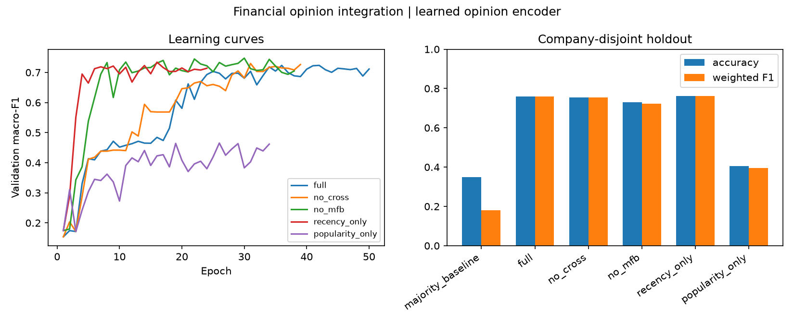
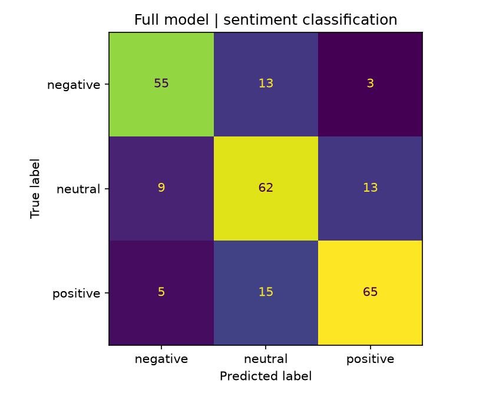
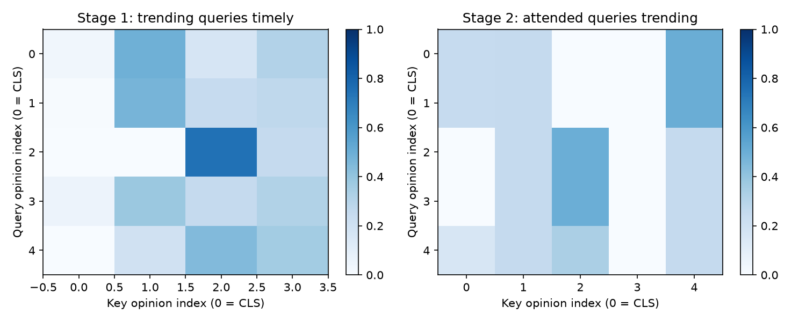

# CrossModalSentimentProject

**Financial sentiment classification from timely news and trending market opinions.**

CrossModalSentimentProject integrates two information streams: recency-driven financial updates and popularity-driven discussions. A two-stage cross-attention network exchanges information between the streams, refines the resulting opinion representations with Transformer layers, and applies multimodal factorized bilinear pooling (MFB) to classify negative, neutral, and positive sentiment.

Both streams contain text. The term cross-modal refers to their different information channels, not an image/audio input system.

## Architecture


## Features

- Variable-length opinion streams, token masks, opinion masks, learned CLS tokens, and positional embeddings.
- Two-stage multi-head cross-attention following the paper's trending-to-timely and attended-to-trending equations.
- Separate Transformer refinement paths and factorized bilinear feature fusion.
- Five trained variants: full network, no cross-attention, no MFB, recency-only, and popularity-only.
- Company-disjoint evaluation, validation-based checkpoint selection, confusion matrices, learning curves, and attention visualizations.
- Batch inference from saved checkpoints.
- Optional frozen local BERT encoder, with no automatic model downloads.

## Installation

Python 3.11 or newer:

```sh
python -m venv .venv
# Windows: .venv\Scripts\activate
# macOS/Linux: source .venv/bin/activate
python -m pip install -e .
```

For a CPU-only installation, install a PyTorch build matching your platform from [PyTorch](https://pytorch.org/get-started/locally/) before installing the project.

## Train, evaluate, and score

```sh
python -m crossmodal_sentiment.cli train --companies 600 --epochs 50 --seed 31 --output reports
python -m crossmodal_sentiment.cli score
python -m unittest discover -s tests -v
```

Training saves the full-model checkpoint locally and publishes model comparisons, histories, attention weights, and representative scoring inputs. The default is CPU execution. Use `--device cuda` on a supported installation; the command fails explicitly when CUDA is unavailable.

A JSON file of opinion pairs can be supplied with `--data path/to/opinions.json`. See [the input schema](docs/METHODOLOGY.md) and the generated [scoring examples](reports/scoring_inputs.json).

## Use local BERT representations

```sh
python -m pip install -e ".[bert]"
crossmodal-sentiment train --encoder bert --bert-path path/to/local/bert --dim 128 --heads 8 --factors 16 --output bert_reports
```

The local directory must contain compatible Hugging Face model and tokenizer files. Files are loaded with `local_files_only=True`; download and review model permissions separately. The BERT backbone is frozen, while projections, attention, Transformers, fusion, and classification layers train. The provided adapter requires BERT padding ID 0.

## Data and results

The reproducible dataset contains **600 synthetic companies with two assessment windows each**, paired with varying numbers of timely and trending opinions. Future publications and engagement measurements are excluded before opinion selection. No original paper dataset, scraped posts, company records, or paper PDF is distributed.

The published experiment uses a **learned token-embedding opinion encoder**, not pretrained BERT. This validates the neural integration architecture independently of model downloads. Local BERT execution is supported but has not been run in the published experiment.

The full network reaches **75.8% accuracy** and **0.759 weighted F1** in the published synthetic experiment. Baselines, ablations, and the initial training record are reported together.

[Executed results](reports/RESULTS.md) · [Metrics and training histories](reports/metrics.json) · [Attention example](reports/attention_example.json) · [Paper mapping](docs/PAPER_MAPPING.md)







## Evaluation scope

Each company's windows remain in one partition. The token vocabulary fits training opinions only; validation macro-F1 selects a checkpoint within each variant, and test results do not tune the architecture. Group splits evaluate transfer to unseen synthetic companies, not temporal market generalization.

Attention weights describe learned routing and are not causal explanations. The generator uses controlled financial phrases and noisy sentiment relationships, so its results do not establish performance on real market language, sarcasm, misinformation, or Chinese-language financial corpora. The task predicts sentiment, not prices, returns, trading signals, or investment outcomes.

## Layout

```text
crossmodal_sentiment/data.py      Opinion schema, as-of filtering, vocabulary and batching
crossmodal_sentiment/network.py   Opinion encoders, cross-attention, Transformers and MFB
crossmodal_sentiment/cli.py       Training, comparisons, checkpointing, scoring and plots
tests/                           Data, mask, gradient, fusion and persistence checks
reports/                         Executed experiment outputs and figures
docs/                            Methodology and source-paper mapping
```
